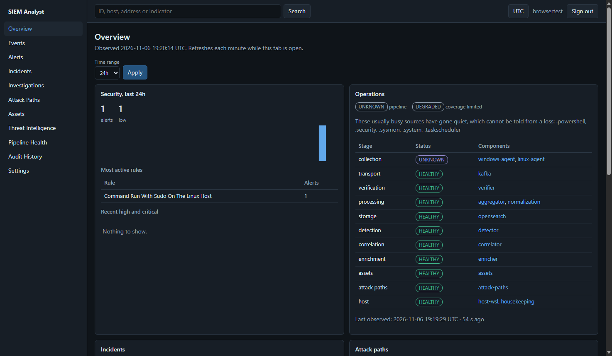
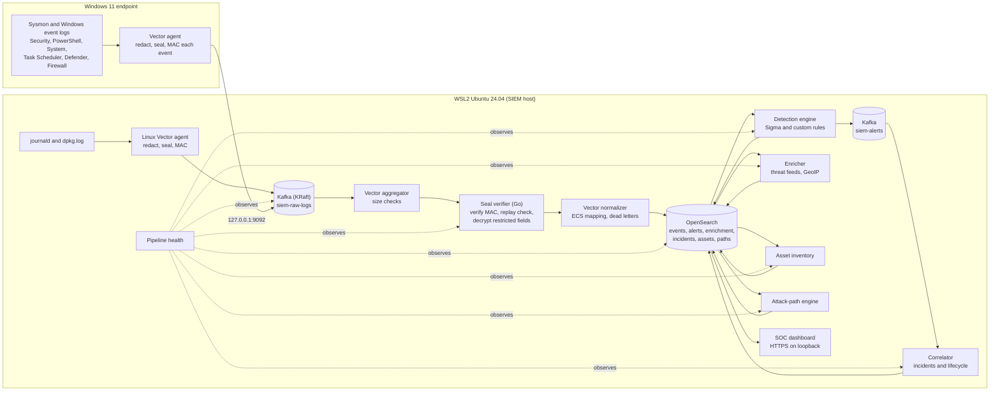
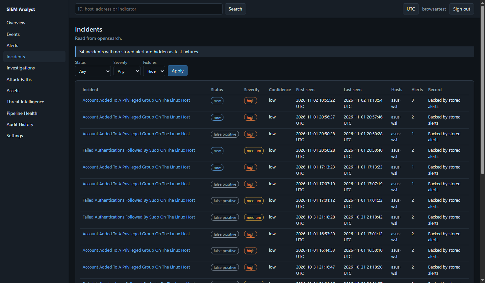
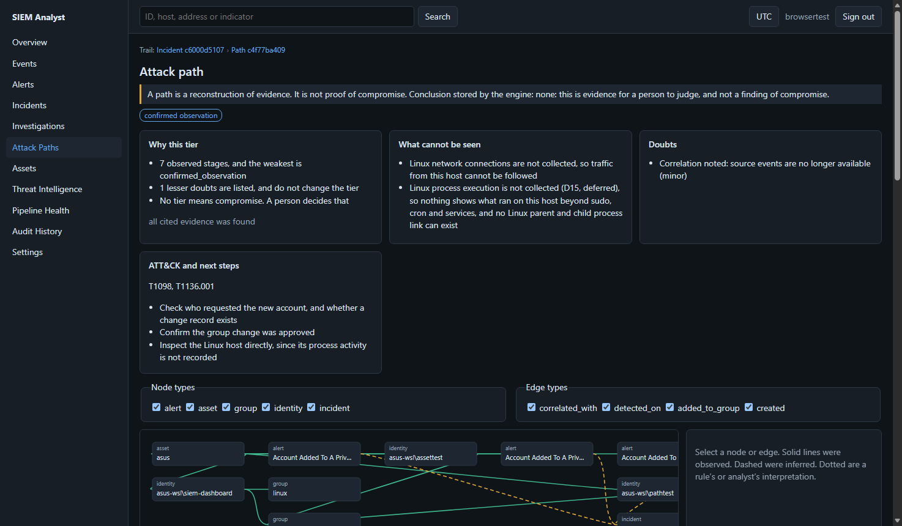
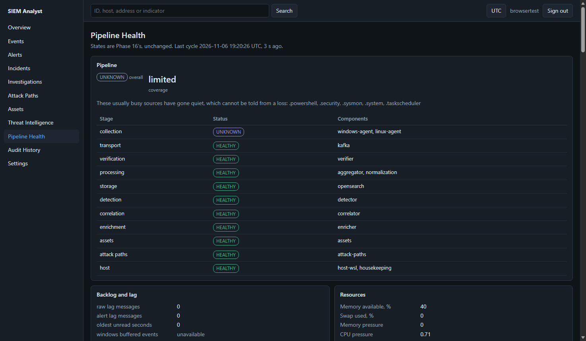

# SIEM Lab: A Self-Hosted SIEM and SOC Workspace

A security information and event management pipeline built from the ground up for a single-machine lab. It covers collection on a Windows 11 endpoint and on Linux, tamper-evident transport, normalization to the Elastic Common Schema, rule-based detection, threat-intelligence enrichment, incident correlation, an asset inventory, attack-path reconstruction, pipeline health monitoring, and a hardened analyst dashboard.

This is **Version 1**, a learning and portfolio project. It runs on one Windows 11 machine, with the SIEM services in WSL2 Ubuntu 24.04. It is not a commercial product, and it has been validated on that one machine only. See [Known limitations](#known-limitations).

## Objectives

- Collect real security telemetry from a Windows endpoint and a Linux host, and never lose or silently alter it.
- Treat log content as hostile: authenticate every event end to end, protect secrets in command lines and scripts, and never execute or render event text as code.
- Detect with readable, testable rules, and explain every alert with the evidence behind it.
- Group alerts into incidents, and show an analyst how they connect, without overstating what the evidence proves.
- Know when the pipeline itself is unhealthy, and tell "unknown" apart from "broken".

## Architecture

Every SIEM service listens on loopback only. WSL2 forwards loopback ports to the Windows host's loopback, and to nothing else. Kafka and OpenSearch are never exposed to the network.

## End-to-end pipeline

1. **Collection.** A native Vector agent on Windows reads seven Windows sources. A second Vector agent inside WSL2 reads the Linux journal and the package log. Each agent keeps only named fields, redacts secret-shaped values, encrypts restricted fields (command lines, script text), and adds an HMAC over the whole event before its disk buffer. See [Windows telemetry](docs/pipeline/windows-telemetry.md) and [WSL2 Linux telemetry](docs/pipeline/wsl2-linux-telemetry.md).
2. **Transport.** Events go to a single-node Kafka broker in KRaft mode, on topic `siem-raw-logs`, which only ever holds sealed envelopes. See [Kafka deployment](docs/operations/kafka-deployment.md).
3. **Verification.** A separate Go service, written with the standard library only, checks each event's MAC in constant time, refuses replays across restarts, and only then decrypts restricted fields. The Vector aggregator holds no field keys. See [ADR-0007](docs/adr/0007-seal-verifier.md) and [ADR-0008](docs/adr/0008-whole-event-authentication.md).
4. **Normalization.** Vector maps events to the Elastic Common Schema, with fixed index templates and retention policies. Anything that fails goes to a dead-letter index, still sealed. See [Ingestion pipeline](docs/pipeline/ingestion-pipeline.md).
5. **Storage.** OpenSearch with TLS and authentication. Each service has its own account, with only the index permissions it needs, and field-level security that withholds command lines and messages from readers that do not need them. See [OpenSearch deployment](docs/operations/opensearch-deployment.md).

## Telemetry sources

| Platform | Sources |
|---|---|
| Windows 11 | Sysmon (with a tuned configuration), Security, PowerShell, System, Task Scheduler, Windows Defender and Windows Firewall logs |
| Linux (the WSL2 SIEM host) | journald, for authentication, sudo, cron, kernel warnings and system services, and `dpkg.log` for package changes |

Linux network connections and process execution are not collected: auditd is deliberately not deployed in Version 1. See [Known limitations](#known-limitations).

## Detection engine

- **30 rules, all enabled:** 24 Sigma rules (17 Windows, 7 Linux) and 6 custom Python rules for patterns Sigma cannot express, such as failed-logon bursts, password spraying, a logon after failures, network beaconing and encoded command content.
- The Sigma rules were written for this project and are all marked `experimental`. They carry 22 distinct MITRE ATT&CK technique tags.
- Sigma rules are parsed and validated by pySigma, then compiled by a project backend to OpenSearch Query DSL, because a Lucene string on a keyword field is case-sensitive and Sigma matching is not. A rule the backend cannot express exactly is refused, never changed.
- Rules run as scheduled queries with watermarks, so a restart neither skips nor repeats a window. Alerts go to Kafka (`siem-alerts`) and OpenSearch, with evidence references back to the events.

See [Detection engine](docs/detection/detection-engine.md) and [Writing rules](docs/detection/writing-rules.md).

## Threat-intelligence enrichment

- **Local feeds, refreshed on a schedule:** abuse.ch Feodo Tracker, Proofpoint Emerging Threats compromised IPs, CINS Army, blocklist.de, Spamhaus DROP, OpenPhish community, Phishing Army, the Tor exit list, and AWS and Google Cloud ranges as context.
- **GeoIP:** country, region and ASN from DB-IP Lite.
- **Optional external providers:** AbuseIPDB, VirusTotal, AlienVault OTX, abuse.ch and CIRCL hashlookup. All are off until configured with a key. They run at alert time only, for structured fields only.
- **Verdicts:** each source is scored independently. One listing alone is usually `suspicious`, and "no known threat" never means safe. Provider text is never stored, because it is untrusted.

See [Threat intelligence](docs/detection/threat-intelligence.md) and [Enrichment](docs/detection/enrichment.md).

## Incident correlation and management

- **12 correlation rules** join alerts by entity (host, user, process, indicator) within time windows, for example a logon after a burst of failures, a service or task followed by its process, or one indicator on several hosts.
- Incidents have a lifecycle (new, open, investigating, contained, resolved, false positive), notes and a hash-chained audit trail. Illegal transitions and missing notes are refused by the correlator itself.
- An analyst works through a local socket or the dashboard. The correlator records every change in its own audit trail. A change made from the dashboard is recorded there under the dashboard's service account, and under the signed-in name in the dashboard's own audit.

See [Incident management](docs/detection/incident-management.md) and [Correlation rules](docs/detection/correlation-rules.md).

## Asset inventory and attack paths

- **Asset inventory:** builds assets from telemetry and from a Windows snapshot collector. It tracks names, addresses, software, services, local identities and relationships. Security-relevant changes wait for review, and identity conflicts are opened, not merged silently. See [Asset inventory](docs/detection/asset-inventory.md).
- **Attack paths:** for each incident, a deterministic, evidence-backed graph of what happened, with edges marked as observed, inferred or interpretation. It is assigned a tier, and it lists its doubts and the gaps in what can be seen. **A path is a reconstruction of evidence, never proof of compromise.** See [Attack paths](docs/detection/attack-paths.md).

## Pipeline health monitoring

A separate, read-only observer assesses 15 components every minute: the two agents, Kafka, the verifier, the aggregator and normalization, OpenSearch, the analysis services, the host, housekeeping timers, and itself.
- **States:** each component is `HEALTHY`, `DEGRADED`, `UNHEALTHY`, `UNKNOWN` or `NOT_APPLICABLE`. Silence alone is `UNKNOWN`, never `UNHEALTHY`.
- **Stability:** hysteresis keeps a state from flapping.
- **History and lag:** a watchdog checks the monitor itself. Transitions are kept append-only, and it tracks Kafka lag, resources and source freshness.
- **Alerts:** status reports reach a Windows-side watcher, which raises desktop alerts.

See [Pipeline health](docs/operations/pipeline-health.md).

## SOC dashboard

A self-hosted web workspace, served over HTTPS on loopback by a Python standard-library server with plain ES modules. There's no framework and no build step. The pages are Overview, Events, Alerts, Incidents, Investigations, Attack Paths, Assets, Threat Intelligence, Pipeline Health, Audit History and Settings.

- **Accounts:** one administrator, created by root on the server. There is no default password, no setup page and no self-registration, and Linux `root` can never be a dashboard login.
- **Passwords and sessions:** scrypt password hashes, and server-side sessions stored only as hashes, in `__Host-` cookies that are Secure, HttpOnly and SameSite=Strict.
- **Request protection:** a session-bound CSRF token plus an origin check, sign-in throttling, and a strict Content Security Policy with no inline script.
- **Rendering:** all event content is rendered as text, never as markup.
- **Least privilege:** the dashboard reads through a field-limited OpenSearch role, and changes records only through each owning service, which validates them.

See [Dashboard](docs/operations/dashboard.md).

## Installation and startup overview

This is a lab build, and installation is manual, component by component, following the guides. A typical host needs Windows 11 with WSL2 Ubuntu 24.04, about 6 GB of memory for WSL, and administrator rights on Windows.

1. **Prepare Windows telemetry.** Install Sysmon with the project configuration, and apply the Windows logging settings. See [Sysmon](docs/operations/sysmon-deployment.md) and [Windows telemetry preparation](docs/operations/windows-telemetry-preparation.md).
2. **Set site paths.** Copy `config/wsl/site.env` to `config/wsl/site.local.env`, and set the Windows folders for your profile. The installers read it, and it is never committed.
3. **Install the core in WSL, as root, from the repository root.**
   - Infrastructure: OpenSearch, then Kafka, then the seal verifier and Vector aggregator (`deploy/wsl/install-aggregator.sh`).
   - Index templates and retention: `deploy/opensearch/apply-index-policy.sh`.
   - Services: the detector, enricher, correlator, asset, attack-path, Linux agent, health and dashboard installers in `deploy/wsl/`.
   - Each service has its own OpenSearch account script in `deploy/opensearch/`.
   - Python dependencies are installed from pinned, hash-checked wheels listed in each `requirements.lock`.
4. **Install the Windows agent.** Run `deploy/windows/install-vector-agent.ps1`. See [Vector agent](docs/operations/vector-agent-deployment.md).
5. **Start and stop.** Use `deploy/windows/siem-up.ps1` and `deploy/windows/siem-down.ps1`. The stack is never enabled at boot.
6. **Create the dashboard account.** As root in WSL: `siem-dashboard-admin create <name>`. Then open `https://localhost:8443/`.

Day-to-day operation is in the [Operations runbook](docs/operations/phase8-operations-runbook.md).

## Technology stack

| Area | Technology |
|---|---|
| Endpoint and Linux agents | Vector 0.61.0 |
| Transport | Apache Kafka 4.4.0, KRaft mode |
| Event verification | Go, standard library only |
| Storage and search | OpenSearch 3.9.0, with the security plugin |
| Detection | Sigma rules, pySigma, Python 3.12 |
| Services | Python 3.12, systemd units with sandboxing |
| Dashboard | Python standard-library HTTPS server, vanilla JavaScript ES modules |
| Endpoint sensor | Microsoft Sysinternals Sysmon (installed by the user, not included) |
| Platform | Windows 11 and WSL2 Ubuntu 24.04 |

There's no Docker, no Kubernetes, no external authentication provider and no paid service.

## Testing and validation

Three kinds of test are kept separate here, because they prove different things.

**Unit tests** run with fixtures and fakes, plus real TLS servers and real service code where a test needs them. Latest runs on the Version 1 code, between 2026-11-06 and 2026-11-07:

| Suite | Tests |
|---|---|
| Detection engine | 126 passed |
| Correlation | 170 passed |
| Enrichment | 172 passed |
| Asset inventory | 201 passed |
| Linux agent and normalization | 39 passed |
| Attack paths | 118 passed |
| Pipeline health | 157 passed |
| Dashboard, including a parallel-session test and allow-lists of every route, menu entry and page | 108 passed |
| Windows alert decisions (PowerShell) | 34 passed |

**Live integration tests** run against the real stack on the lab machine, with real telemetry.

| Check | Date and code | Result |
|---|---|---|
| Real Edge browser: every page, link checks, no script or policy errors | 2026-11-07, final Version 1 code | 60 of 60 |
| Install from the public files only, then startup, shutdown and pipeline health | 2026-11-07, final Version 1 code | Passed |
| Dashboard against real data: counts agree with independent queries | 2026-11-06, before the final dashboard changes | 45 of 45 |
| Dashboard security: sessions, CSRF, origin, rate limits, refused correlator moves | 2026-11-06, before the final dashboard changes | 62 of 62 |
| Dashboard leak crawl: 383 responses, checked for 311 real restricted values | 2026-11-06, before the final dashboard changes | 4 of 4, none exposed |

The three dashboard suites need a server with no dashboard account, so they were not repeated after an account was created. The final dashboard changes removed routes and filtered views, and are covered by the unit tests and the browser run above.

Earlier phases recorded their own live security, resilience and real-data suites at acceptance. Some of those, such as the Linux, attack-path and asset security stages, create test accounts or synthetic alerts, so they were not repeated for this release.

**Not validated:**
- Attacks from a separate attacker machine, including the planned Kali VM. Detections were tested on controlled activity on the monitored hosts themselves.
- More than one monitored Windows endpoint, or a separate SIEM server.
- Sustained high event volume, and long-term retention behaviour beyond a few weeks.

## Known limitations

- **Single machine.** The SIEM shares a host with its monitored Windows endpoint, so a compromise of Windows is a compromise of the SIEM. That is an accepted lab risk, and multi-host behaviour is unverified.
- **Kafka has no authentication.** It is reachable on loopback only, and it only carries sealed envelopes, but any local process can read them.
- **Linux visibility is partial.** There is no auditd, so there are no Linux process executions or network connections.
- **No ML detection.** ML anomaly detection is not built. Detection is rule-based only.
- **Rules are young.** They are tuned against one lab's activity, and all Sigma rules are `experimental`.
- **One dashboard account, and no second factor.**
- **The dashboard is not monitored.** Pipeline health does not watch the dashboard service, so if it stops, nothing raises an alert.
- **Private certificate.** The dashboard uses a private certificate, so a browser warns until you trust it.
- **Manual installation.** There is no single installer, and wheels must be downloaded by the operator and verified against the locks.
- **Feed terms.** Threat feeds are downloaded at run time, and each feed's own terms of use apply to whoever runs it.

## Version 2 roadmap

- AI-assisted incident analysis, as advisory output for human review only.
- Generated incident reports, with delivery to email, Slack or ticketing.
- Analyst feedback on true and false positives, used to tune rules.
- ML-based anomaly detection, once there is enough baseline data.
- Linux process and network auditing.
- Controlled attack simulation from a separate attacker machine, with an attack ledger to measure detection coverage.
- Multi-host support and a dedicated SIEM server.
- Kafka authentication, and multi-user dashboard accounts with a second factor.

## Repository layout

| Path | Contents |
|---|---|
| `detector/`, `enricher/`, `correlator/`, `inventory/`, `attackpath/`, `health/`, `dashboard/` | The Python services |
| `services/seal-verifier/` | The Go event verifier |
| `rules/` | Sigma rules, custom rules and correlation rules |
| `config/` | Vector, Sysmon, OpenSearch templates and service settings |
| `deploy/` | Installers, systemd units and Windows scripts |
| `tests/` | Unit and live test suites |
| `docs/` | Architecture decisions (ADRs), pipeline, detection and operations guides |

Start with the [technical architecture](docs/architecture/technical-architecture-windows-wsl2.md) and the [decision index](docs/adr/decision-status.md).

## Licence

Released under the [MIT License](LICENSE). Third-party data, names and software keep their own licences and terms. See [NOTICE](NOTICE). In particular, IP geolocation data is provided by [DB-IP](https://db-ip.com), and MITRE ATT&CK® is a registered trademark of The MITRE Corporation.
